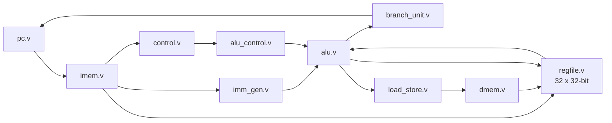

# Single-Cycle RISC-V (RV32I) Processor in Verilog

A single-cycle RISC-V CPU that implements the full **RV32I base integer ISA**: all 37 user-level instructions, with `fence`, `ecall` and `ebreak` decoded as no-ops (40 instructions in total). Built for the Computer Organization & Architecture course at NIT Srinagar (2026).

The design is checked against an independent **golden reference model**: a Python instruction-set simulator (ISS) runs the same self-checking test program that the Verilog testbench runs.

## Datapath



Every instruction finishes in one clock cycle. The clock period is therefore set by the slowest path, a load: instruction memory → register file → ALU → data memory → register file.

## Repository layout

| Path | Contents |
| --- | --- |
| `rtl/` | 11 Verilog modules; top level `riscv_single_cycle.v`; shared constants in `riscv_defs.vh` |
| `tb/tb_riscv.v` | Testbench: loads `program.hex`, runs until the program signals pass/fail |
| `tb/program.s` | Self-checking test program (51 tests covering all 40 instructions) |
| `tb/program.hex`, `tb/program.lst` | Assembled program and listing |
| `tools/rv32i_asm.py` | Small RV32I assembler (`.s` → `.hex` + `.lst`) |
| `tools/rv32i_iss.py` | Instruction-set simulator used as the reference model |

## Verification

Reference model (Python 3, no dependencies):

```bash
python tools/rv32i_asm.py tb/program.s tb/program.hex tb/program.lst
python tools/rv32i_iss.py tb/program.hex
# PASS after 326 instructions, instruction coverage: 40/40
```

RTL simulation with Icarus Verilog:

```bash
iverilog -g2005 -I rtl -o sim.out tb/tb_riscv.v rtl/*.v
vvp sim.out          # expected: PASS: all tests passed in 326 cycles
gtkwave riscv.vcd    # waveforms
```

Status: the reference model passes (above). The RTL has been reviewed and hand-traced against it; an Icarus Verilog run is the next step.

## Not in scope

No pipeline, no caches, no CSRs, and no exceptions or traps (`ecall`/`ebreak` are no-ops). Misaligned memory accesses are not supported. A 5-stage pipeline (IF, ID, EX, MEM, WB) with forwarding and hazard detection is the natural next step.
